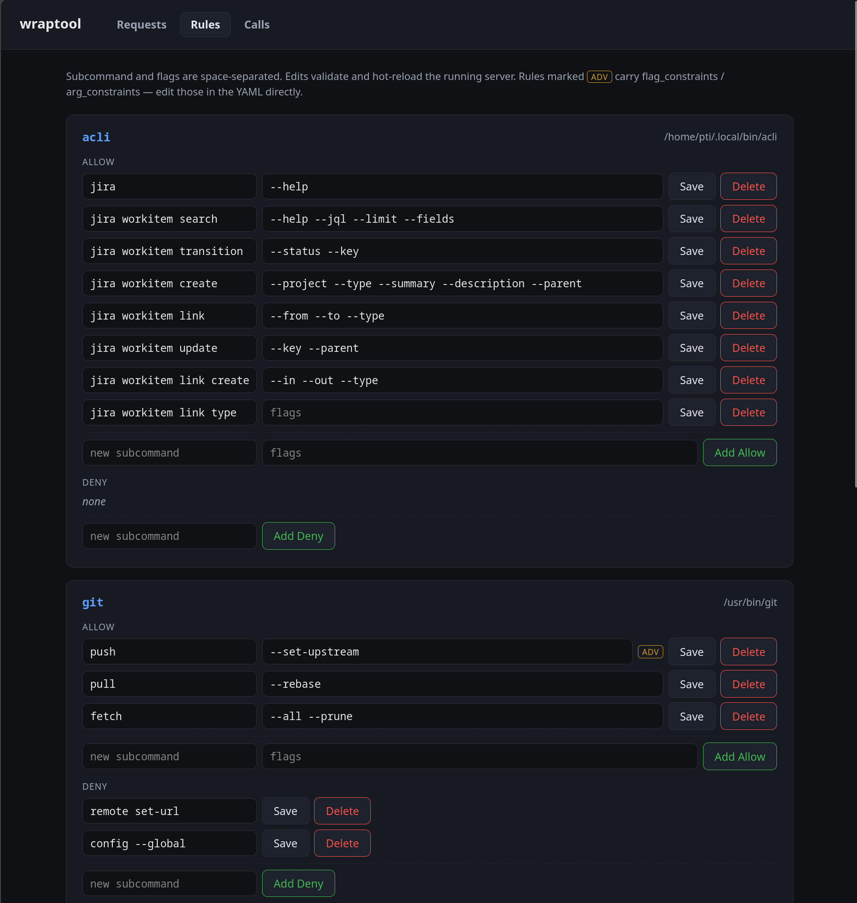

# wraptool

An MCP server that wraps CLI tools behind a security whitelist, so AI
coding assistants can use tools like `git`, `gcloud`, and `kubectl`
without direct access to credentials.

## Why

AI coding assistants need CLI tools to be productive, but giving them
direct access exposes API keys, SSH keys, kubeconfigs, and service
account credentials to the model context. wraptool sits between the
assistant and the tools:

- **Credentials stay isolated** -- wraptool runs as a separate process
  with its own environment; secrets never enter the AI context.
- **Subcommand-level whitelisting** -- allow `git commit` but deny
  `git push --force`, with flag-level granularity and value
  constraints.
- **Auto-discovery** -- wraptool parses `--help` output to generate
  MCP tool schemas with real descriptions.
- **Structured denial workflow** -- denied commands trigger a
  capability-request flow that an operator approves from the CLI.

## Quick start

```bash
go build -o wraptool .
wraptool init --harness claude --url http://127.0.0.1:8717/sse
wraptool serve
```

## Web UI

An optional operator-facing dashboard (bound to `127.0.0.1`, **not**
AI-facing) reviews capability requests and provides full rule CRUD —
edit a tool's allow/deny rules in the browser and the running server
hot-reloads the change. See [`docs/web-ui.qmd`](docs/web-ui.qmd).



## Documentation

Full documentation lives in `docs/` and is rendered with
[Quarto](https://quarto.org/) to a website (published via GitLab
Pages):

| Page | Source |
|------|--------|
| Getting started | [`docs/getting-started.qmd`](docs/getting-started.qmd) |
| Configuration reference | [`docs/configuration.qmd`](docs/configuration.qmd) |
| Security model | [`docs/security.qmd`](docs/security.qmd) |
| Hot-reload & capability requests | [`docs/hot-reload.qmd`](docs/hot-reload.qmd) |
| Request-review Web UI | [`docs/web-ui.qmd`](docs/web-ui.qmd) |
| Isolated environments | [`docs/isolated-environments.md`](docs/isolated-environments.md) |
| Overview slides | [`docs/presentation.qmd`](docs/presentation.qmd) |

### Build the site locally

```bash
quarto preview docs        # live-reloading dev server
quarto render  docs        # produce docs/_site/
```

## License

GPLv3 -- see [LICENSE](LICENSE).
